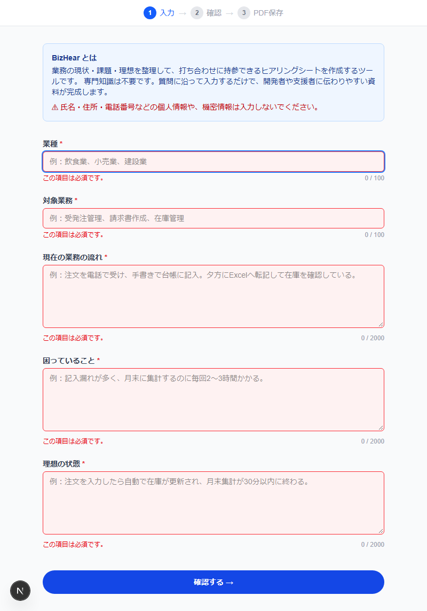
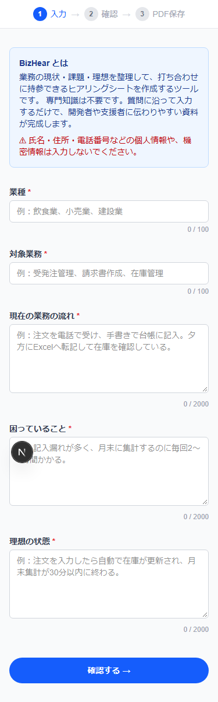

# BizHear – 業務改善ヒアリングシート作成ツール

業務の現状・課題・理想を整理して、打ち合わせに持参できるヒアリングシートを作成するWebツールです。  
専門知識がなくても、定型の質問に回答するだけで開発者・業務改善支援者に伝わりやすい資料が完成します。

## スクリーンショット

| 入力フォーム | バリデーション | 確認画面 | スマートフォン |
|---|---|---|---|
|  |  |  |  |

## 機能（MVP）

- **サービス説明** — 対象者・使い方・個人情報の注意を表示
- **入力フォーム** — 業種・対象業務・現状の流れ・困りごと・理想の状態を入力（5項目）
- **入力検証** — 必須チェック・文字数チェック・項目別エラー表示
- **確認画面** — 入力内容を見出し付きで表示、修正のためフォームへ戻れる
- **PDF保存** — ブラウザ印刷ダイアログから「PDFに保存」でA4縦のシートを出力
- **レスポンシブ** — デスクトップ〜幅375pxのスマートフォンに対応

## 技術スタック

| 分類 | 技術 |
|---|---|
| フレームワーク | Next.js 16 (App Router) |
| UI | React 19 |
| スタイル | Tailwind CSS v4 |
| 言語 | TypeScript 5 (strict mode) |
| ビルド | Turbopack |
| ホスティング | Vercel |

## 起動方法

```bash
npm install
npm run dev
```

ブラウザで [http://localhost:3000](http://localhost:3000) を開いてください。

```bash
npm run build   # プロダクションビルド
npm run lint    # ESLintチェック
```

## 画面構成

```
/          入力フォーム（業種・対象業務・現状・課題・理想）
└─ /review  確認画面（PDF出力 / 入力に戻る）
```

- 画面間の入力データは React Context でクライアント側のみに保持します。
- `/review` をリロードまたは直接アクセスした場合は入力画面へリダイレクトします。
- サーバーへのデータ送信・保存は一切行いません。
